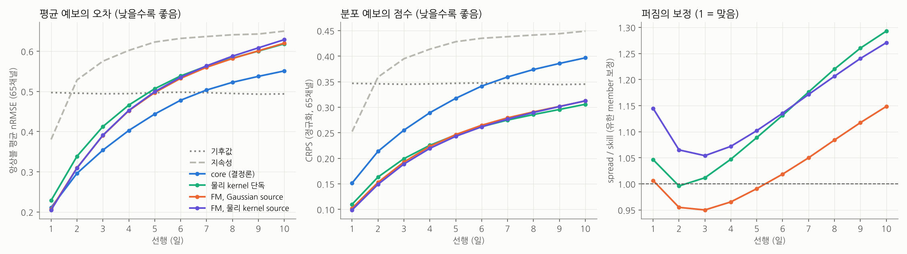
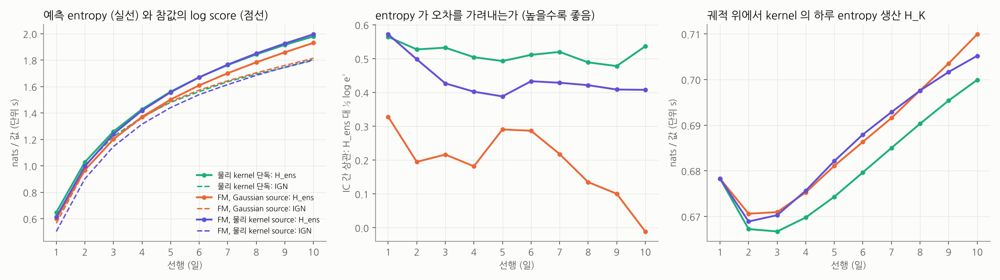

# 방정식 → 분포 → 10일 ensemble: 물리 kernel 을 source 로 하는 flow matching (2026-11-20)

## 요청을 이렇게 읽었습니다

소유자 요청(2026-11-20): "physical_guide_flowmatching 에서 tendency core 를 확인하고, 원시식을 kernel 형태의 distribution 으로 만들고 flow matching 에 넣어서 ensemble 예측 구조를 만들어 10일 예측 구조를 만들고, 이를 통해서 물리 분포를 통한 예측 구조를 만든다." 프로젝트 설명: "G(x) → Σ K(x,y) 의 K 를 통해서 distribution 을 구성해서, flow matching 의 distribution 을 통해서 G(x) → K(x,y) → 예측(10일)에 대한 entropy 예측 구조." 메인 코드는 이 저장소입니다.

kernel 의 구체적인 식은 정해져 있지 않아서 아래 해석을 택했습니다. 다른 해석으로 바꾸는 데 필요한 자리는 4절에 적었습니다.

## 1. 출발점: tendency core

`physical_guide_flowmatching` 의 최신 작업 브랜치(`claude/project-thread-c97r6n`, commit 5d38e56)를 확인했습니다. 이 저장소의 `third_party/pgfm` 에 그 코드가 그대로 들어 있어 거기서 학습한 core 가 여기서 그대로 로드됩니다.

    dx/dt = f_θ(x, G(x), static, 시각)          x: 66개 동적 채널 (KAI 계약, 정규화)
    G(x)  = −R0(x)                               이산 원시방정식 연산자가 낸 u, v, T, q × 12층의 경향 = 48 물리항
    Φ(x)  = Heun 한 step = 하루                  (tisr 강제, PositiveMass)

`docs/kai_tendency.md` 5절의 core_gng 가 이 형태입니다(물리항이 1일 nRMSE 를 5 % 줄임). 기억 core(core_gngmz8)는 member 마다 기억 상태를 따로 가져야 해서 이번 첫 구현에서는 plain core 만 받습니다(4절).

## 2. 구조

### 2.1 방정식 → 분포: 물리 kernel

    K(x, y) = (1/N) Σ_k  N( y ; Φ(x + ε ⊙ s ⊙ δ_k) , diag (s ⊙ h(x))² )

| 기호 | 뜻 | 학습 |
| --- | --- | --- |
| Φ | tendency core 의 하루 (G(x) 포함) | 얼림 |
| δ_k | 3 × 3 격자로 매끄럽게 한 단위 noise, ±δ 쌍 (중심들의 평균이 Φ(x) 근처에 남음) | |
| ε | 채널별, 방정식을 x 에서 얼마나 떨어진 점들에서 출발시키는가 (분석 불확실성) | NLL |
| h(x) | 채널 × 격자점별 폭. 입력 [x, G(x), (Φ(x) − x)/s, 정적 장, 시각] | NLL |
| s | 채널별 하루 변화의 표준편차 (`core.t6`). 모든 분포의 단위 | |

- **Σ K(x,y) 의 뜻.** 방정식이 x 주변의 점 구름을 하루 적분하고, 그 도착점마다 kernel 을 놓아 더한 것(kernel density)이 다음 날의 분포입니다. 방정식이 구름을 늘리는 방향(불안정한 곳)으로 분포가 넓어지므로 폭이 흐름에 따라 달라집니다. 방정식이 정하지 못하는 나머지(closure 의 오차, 격자 아래의 운동)는 h(x) 가 맡습니다.
- **학습.** 관측된 다음 날 y 의 음의 로그 우도. 66 × H × W 차원의 혼합 우도는 가장 가까운 중심 하나로 쏠리므로, 채널 × 격자점별 주변 우도의 합(composite likelihood)을 씁니다. 표본은 장 전체에서 중심 하나를 고르고 매끄러운 noise 를 더해 뽑으므로, 주변 분포는 학습한 그대로입니다.
- **entropy.** 한 값당 Gaussian(모멘트) entropy, ½ log(2πe · (중심의 분산 + h²)), s 단위의 nats. kernel 합 자체의 주변 entropy 의 상한이고, 방정식이 하루 동안 만드는 entropy 생산입니다.

### 2.2 분포 → 분포: kernel 을 source 로 하는 flow matching

증분 단위 z = (y − x)/s 에서

    z0 ~ K(x, ·) 를 증분으로       (source: 물리 kernel 의 표본)
    z1 = 관측된 다음 날의 증분      (target)
    z_τ = (1 − τ) z0 + τ z1 + σ_min n,     u = z1 − z0
    loss = || v_θ(z_τ, τ | x, G(x), (Φ(x) − x)/s, log h(x), 정적 장, 시각) − u ||²   (면적 가중, tisr 제외)

- source 와 target 은 x 가 주어졌을 때 독립으로 뽑으므로, 학습된 흐름은 K(x, ·) 를 다음 날의 조건부 분포로 옮깁니다(conditional flow matching 의 주변 보존 성질).
- 속도 head 가 0 에서 시작하므로 **학습 전의 모델은 물리 kernel 그 자체**입니다. 흐름은 kernel 이 틀린 만큼(편향, 모양)만 배우고, 옮기는 거리가 짧아 적분 step 이 적어도 됩니다(Heun 6 step).
- 대조군 `--source gauss`: 같은 망, 같은 조건(G(x), Φ(x) 포함)에 source 만 x 주변의 매끄러운 N(0, I)(s 단위)로 바꾼 표준 flow matching. 물리가 "조건"으로만 들어갈 때와 "분포"로 들어갈 때를 가릅니다.

### 2.3 10일 ensemble 과 entropy 예측

member 마다 자기 궤적을 갑니다: 매일 K(x_t^m, ·) 에서 뽑고(새 중심과 새 폭 noise), 흐름으로 옮겨 다음 날 상태로 삼습니다. 퍼짐은 방정식(섭동된 점들의 적분)과 학습된 폭, 흐름을 지나 자랍니다.

| 양 | 식 (한 값당, s 단위 nats) | 뜻 |
| --- | --- | --- |
| H_ens(L) | ½ log(2πe · var_m(x_L^m)/s²) | 선행 L 일 예보 분포의 entropy (예측된 entropy) |
| H_K(L) | member 평균의 kernel entropy | L 일째에 방정식이 만드는 하루치 entropy 생산 |
| IGN(L) | ½ log(2π var/s²) + e²/(2 var), e = 앙상블 평균 − 참값 | 참값의 Gaussian log score |

- 보정이 맞으면 E[IGN] = H_ens 입니다(entropy = 참값이 주는 놀람의 기댓값). IGN − H_ens > 0 이면 ensemble 이 지나치게 확신합니다.
- IC 마다 H_ens 와 ½ log(e²/s²) 의 상관은 예측된 entropy 가 좋은 예보와 나쁜 예보를 가려내는지를 봅니다.
- 함께 내는 점수: 앙상블 평균 nRMSE(65채널, 정규화 RMSE 평균), fair CRPS, spread/skill, 주요 변수(z500, t850, t2m, u850, v850, q700, msl, u250)의 물리 단위 RMSE.

## 3. 명령

```bash
pip install -r requirements.txt
python third_party/pgfm/scripts/wb2_to_kai.py --out data/era5_5p625 --daily-mean --no-climode --years 2014 2015 2016 2017
python scripts/run_fpk.py core --iters 3000                       # core_gng: GroupNorm, G(x), rollout 1~4일
python scripts/run_fpk.py kernel --iters 600 --batch 4 --centres 4
python scripts/run_fpk.py flow --source kernel --tag flow
python scripts/run_fpk.py flow --source gauss --tag flow_gauss
python scripts/run_fpk.py score --arms persistence core kernel flow flow_gauss --kernel-entropy
python scripts/report_fpk.py runs/fpk/score.json --out docs/results
python -m pytest -q tests

# 7~9절: 메모리 core, rollout 미세조정, entropy 편차 kernel, 편차 kernel source FM
python scripts/run_fpk.py core --core-tag core_gngmz8 --iters 2000 -- --core-mem 8 --core-mz --curriculum 1 2 3 4 6 8 --resume
python scripts/run_fpk.py kernel --core-tag core_gngmz8 --tag kernel_m --iters 600
python scripts/run_fpk.py flow --core-tag core_gngmz8 --kernel-tag kernel_m --tag flow_m --iters 2500
python scripts/run_fpk.py tune --core-tag core_gngmz8 --kernel-tag kernel_m --flow-tag flow_m --tag flow_mt --days 2 3 3 3 --batch 1 --steps 3 --through --lr 1e-4 --iters 320
python scripts/run_fpk.py devk --tag devk                         # --core-tag core_gngmz8 --tag devk_m
python scripts/run_fpk.py devflow --dev-tag devk --tag devflow    # --source gauss --tag devflow_gauss
python scripts/run_fpk.py score --arms devk devflow devflow_gauss --score-tag score_dev
python scripts/summary_fpk.py; python scripts/eval_fpk_vars.py ...; python scripts/plot_fpk_vars.py ...
```

PG-CFM 에서 이미 학습한 core 를 쓰려면 `runs/kaitend/<tag>.pt` 와 같은 폴더의 `stats.npz` 를 `--out` 폴더에 두고 `--core-tag <tag>` 를 줍니다(plain core 만).

## 4. 정한 가정과 바꿀 수 있는 자리

- **kernel 의 형태.** 중심 = 섭동된 점들의 방정식 적분, 폭 = 학습. 다른 해석(예: Green 함수 형태의 적분 연산자 ∫K(x,y)φ(y)dy, 또는 G(x) 의 물리항별 불확실성을 직접 공분산으로 쓰는 형태)은 `fpk/kernel.py` 의 `centres` / `bandwidth` 만 바꾸면 됩니다.
- **core 는 얼림.** 방정식 부분은 PG-CFM 에서 학습한 그대로 두고 분포의 부분만 학습했습니다.
- **기억 core 미지원.** member 마다 ConvGRU 기억을 복제해 굴리는 것이 다음 단계입니다.
- **entropy 는 Gaussian 모멘트 근사.** 앙상블 8 member 로는 비모수 entropy 를 추정할 수 없습니다.
- **CPU 크기.** 5.625°, 학습 2년, 시험 2017년 IC 6일 간격. GPU 에서는 같은 명령에 `--device cuda` 와 긴 학습을 줍니다.


## 5. 첫 결과 (CPU, 2017년, IC 60개 × member 8개)

설정: ERA5 5.625° 일평균, 학습 2014~15, 검증 2016. core_gng 3,000 it(검증 1일 손실 0.265), kernel 600 it(검증 NLL 0.948 → 0.673, ε ≈ 0.23 s, h ≈ 0.50 s), flow 2,500 it 씩(물리 kernel source 0.748 → 0.493, Gaussian source 1.948 → 0.728). 전체 표는 [`results/tables.md`](results/tables.md), 수치는 [`results/scores.json`](results/scores.json).





| 선행 1 / 3 / 5 / 7 / 10일 | 앙상블 평균 nRMSE | CRPS | spread / skill | IC 간 상관 (entropy 대 오차) |
| --- | --- | --- | --- | --- |
| core (결정론) | 0.211 / 0.354 / 0.444 / 0.503 / 0.551 | 0.152 / 0.255 / 0.317 / 0.359 / 0.397 | | |
| 물리 kernel 단독 | 0.229 / 0.413 / 0.507 / 0.563 / 0.618 | 0.110 / 0.199 / 0.246 / **0.275 / 0.306** | 1.05 / 1.01 / 1.09 / 1.18 / 1.29 | **0.56 / 0.53 / 0.49 / 0.52 / 0.54** |
| FM, Gaussian source | 0.207 / 0.390 / 0.497 / 0.560 / 0.620 | 0.102 / 0.193 / 0.246 / 0.279 / 0.312 | 1.01 / 0.95 / 0.99 / 1.05 / 1.15 | 0.33 / 0.22 / 0.29 / 0.22 / −0.01 |
| FM, 물리 kernel source | **0.205** / 0.391 / 0.499 / 0.564 / 0.629 | **0.099 / 0.189 / 0.243** / 0.277 / 0.313 | 1.15 / 1.05 / 1.10 / 1.17 / 1.27 | 0.57 / 0.43 / 0.39 / 0.43 / 0.41 |

읽는 법:

1. **분포 예보로는 세 ensemble 모두 결정론 core 보다 크게 낫습니다.** CRPS 가 1일 −35 %, 10일 −21~23 %입니다. 1~5일은 물리 kernel source 의 FM 이 가장 좋고(Gaussian source 대비 1일 −3 %, 3일 −2 %), 7~10일은 kernel 단독이 가장 좋습니다.
2. **예측 entropy 가 어느 예보가 틀릴지를 알려 주는 것은 물리 kernel 이 들어간 쪽뿐입니다.** IC 마다의 entropy 와 실제 오차 크기의 상관이 kernel 단독 0.49~0.56, 물리 kernel source FM 0.39~0.57 로 10일까지 유지됩니다. Gaussian source FM 은 0.33 에서 시작해 10일에 0 이 됩니다. 같은 망, 같은 조건(G(x), Φ(x) 입력)이므로 차이는 source 분포입니다. 물리가 조건으로만 들어가면 예측 가능성의 정보가 퍼짐에 실리지 않고, 분포로 들어가면 실립니다. 이 구조의 핵심 주장이고 이 결과가 뒷받침합니다.
3. **약점: 앙상블 평균이 결정론 core 보다 나쁩니다.** 3일부터 nRMSE 가 core 보다 높고(3일 0.39 대 0.354, 10일 0.62~0.63 대 0.551) 7일부터는 기후값(0.497)보다도 높습니다. 보통 앙상블 평균은 결정론보다 좋아야 합니다. member 마다 매일 독립적인 폭 noise 와 섭동을 받고 그 상태에서 다시 방정식을 푸므로 member 하나하나가 결정론 궤적보다 빨리 나빠지고, 8개의 평균으로는 그것을 되찾지 못합니다. kernel 과 flow 는 하루 쌍으로만 학습되어 자기 rollout 의 오차 누적을 보지 못했습니다.
4. **퍼짐: 긴 선행일에서 과대합니다.** spread / skill 이 10일 1.15~1.29 이고, 같은 방향으로 5일 이후 IGN 이 H_ens 보다 작습니다(entropy 가 실제 놀람보다 큼). 1일에는 물리 kernel source FM 이 1.15 로 넓고 Gaussian source 가 1.01 로 맞습니다.
5. 물리 단위로 보면 1일 z500 RMSE 는 FM 두 가지가 core 와 비슷하고(195~204 대 199 m²/s²) 3일부터 core 가 앞섭니다.

다음 단계 (효과가 큰 순서):

1. **rollout 학습.** kernel 과 flow 를 2~4일 자기 rollout 의 CRPS(또는 energy score)로 미세조정해서 member 오차의 누적과 과대 퍼짐을 함께 잡습니다. 3번 약점의 직접적인 원인을 겨냥합니다.
2. **평균과 편차의 분리.** 결정론 궤적(core 또는 KAI 연결)을 평균으로 두고 kernel·flow 는 그 둘레의 편차만 내게 합니다. PG-CFM 의 "회귀 평균 + FM 편차" 가정과 같은 형태입니다.
3. **기억 core.** member 마다 ConvGRU 기억을 복제해 core_gngmz8 을 방정식으로 씁니다.
4. GPU 에서 1.5° 와 긴 학습.

## 6. 변수별 평가 (PG-CFM 의 `eval_kai_channel_gains.py` 형식)

`scripts/eval_fpk_vars.py` 가 z500 · z850 · t850 · t2m · msl · u850 · v850 · wind850 · u250 · v250 · wind250 을 변수별로 냅니다: core 대비 RMSE 이득 %(IC paired bootstrap 95 % 구간), 그 이득의 정보 항 / 진폭 항 분해, ACC, 활동도, CRPS(물리 단위), spread / skill, entropy, entropy-오차 상관. 전체 표는 [results/vars.md](results/vars.md), 수치는 `results/vars.json` 입니다.

    python scripts/eval_fpk_vars.py runs/fpk/score_det runs/fpk/score_kernel runs/fpk/score_flow runs/fpk/score_flowg \
        --ref core --out docs/results/vars.md --json docs/results/vars.json

읽은 것 (2017년, IC 60개 × member 8개):

1. **CRPS 는 11개 변수 모두, 모든 선행일에서 core 보다 좋습니다.** 10일 기준 z500 547 → 478~508 m²/s², t850 2.67 → 2.16~2.43 K, u250 9.47 → 6.87~7.13 m/s.
2. **앙상블 평균 RMSE 는 3일부터 모든 변수에서 core 보다 나쁩니다** (3일 −8~−26 %, 10일 −1~−29 %). 1일에는 FM 두 가지가 core 와 비슷합니다(z500 +1.8 % / −2.5 %).
3. **손실의 성격이 선행일에 따라 다릅니다.** 3일의 손실은 대부분 정보 항입니다(z500 −14~−25 % 중 정보 −14~−25 %): 매일의 섭동과 폭 noise 가 종관 규모의 위상 정보를 깎습니다. 10일의 손실은 대부분 진폭 항입니다(z500 FM −19 % 중 진폭 −17 %, 정보 −2 %): core 는 10일에 활동도 0.73 으로 매끄러워져 RMSE 를 줄이는데, member 8개의 평균은 활동도 0.81~0.95(온도는 1.1~1.4)로 덜 매끄럽습니다.
4. **온도(t850, t2m)가 가장 과하게 퍼집니다**: spread / skill 10일 1.31~1.47. 지위·기압은 물리 kernel 쪽이 1.1~1.2, Gaussian source 는 0.83~0.89 로 오히려 부족합니다.
5. entropy-오차 상관은 변수별로도 물리 kernel 쪽이 10일까지 유지됩니다(z500 10일: kernel 0.54, FM 물리 kernel 0.40, FM Gaussian 0.01).

3번이 다음 실험의 근거입니다: 3일의 정보 손실은 rollout 학습과 기억으로, 10일의 진폭·과대 퍼짐은 평균/편차 분리와 entropy 로 크기를 정하는 편차 kernel 로 겨냥합니다.

## 7. 메모리 항의 kernel 화와 rollout 확장

**메모리 core.** `core_gngmz8`: ConvGRU 기억 m(24채널, 8일 teacher forcing, Mori-Zwanzig innovation), rollout curriculum 1·2·3·4·6·8일, 2000 iteration. 결정론 10일 nRMSE 0.551 → 0.517 (3일은 0.354 → 0.360 으로 비슷).

**메모리 kernel.** kernel 합을 상태와 기억의 구름으로 넓혔습니다 (`fpk/kernel.py`):

    K(x, m, y) = (1/N) Σ_k N( y ; Φ(x + ε s δ_k ; m + ε_m δ'_k) , diag (s h(x, G, m))² )

member 마다 자기 기억을 가집니다. `start` 가 IC 앞 8일로 기억을 채우고, 매일 `observe` 가 그 member 의 상태로 한 번 갱신하며, 기억이 보는 innovation 은 "member 상태 − 방정식의 예보 Φ(x; m)" 입니다. ε_m 은 기억 채널마다 학습됩니다(0.1 → 0.076). 폭 h 와 flow 의 조건도 m 을 읽습니다.

**rollout 미세조정.** `run_fpk.py tune`: member M 개를 D 일 돌리며 매일의 fair CRPS(s 단위) + λ × 하루 loss 를 줄입니다. `--through` 는 뒤 날의 점수가 앞 날의 상태를 거쳐 되돌아가게 합니다(flow 는 기본적으로 상태 Jacobian 을 항등으로 두고, `--through-core` 가 방정식의 Jacobian 까지 포함).

결과:

- kernel 의 rollout 미세조정은 효과가 1 % 안팎입니다(6일 CRPS 0.726 → 0.718). kernel 의 자유도는 ε 과 h 뿐입니다.
- flow 의 rollout 미세조정(2~3일)은 10일 CRPS 0.313 → 0.293, 앙상블 평균 nRMSE 0.629 → 0.596 이고, 학습에 쓰지 않은 4~10일에도 이득이 유지됩니다.
- 메모리 kernel 자체의 이득은 작습니다(10일 CRPS 0.306 → 0.299). 메모리 + flow + rollout 은 10일 CRPS 0.285, 1일 0.097(전체 중 최저), entropy–오차 상관 0.57~0.65.
- 과한 퍼짐은 남습니다(10일 spread / skill 1.29). member 가 각자 noise 가 든 궤적을 도는 구조의 성질입니다.

## 8. entropy 로 편차를 만드는 kernel

`fpk/devkernel.py`. 평균과 편차를 나누고, 편차의 크기를 entropy 예산으로 정합니다.

    평균      x̄_(L+1) = Φ(x̄_L)                              core 의 궤적 (기억 포함)
    member    x_L = x̄_L ± s e_L                              대칭 쌍 P 개
    방향      p = [Φ(x̄ + s e) − Φ(x̄ − s e)] / (2 s)           방정식이 편차를 실어 나름 (kernel 의 섭동 쌍)
    새 부분   q = p + h ξ                                     방정식이 정하지 않는 부분
    크기      e_(L+1) = q · exp(r)
    entropy   H_(L+1) = ½ log⟨q²⟩ + r(x̄, G, m, …)             = 방정식의 늘림 + 학습된 잔차

하루 entropy 생산은 H_(L+1) − H_L = (방정식의 늘림률) + (잔차 r) 입니다. 학습은 여러 날 rollout 에서 평균 둘레의 Gaussian log score, IGN = H + err² / (2 e^{2H}) 를 줄이는 것이고, 최소점이 보정된 entropy(E[IGN] = H)입니다. core 는 고정이고 core 를 통한 gradient 는 없어서 학습이 가볍습니다.

읽은 것:

- 학습된 늘림률은 1일 0.53 → 10일 0.08 nats 로 줄고, 잔차는 3일부터 음수(−0.04 ~ −0.08)입니다. 방정식만으로는 구름이 조금 과하게 커지고 학습된 항이 깎습니다.
- **평균은 core 그대로**(쌍의 평균 = x̄), **spread / skill 1.00~1.07**(메모리 core 위 1.00~1.05), **entropy–오차 상관 0.61~0.66**.
- 10일 CRPS 0.285(plain core), **0.268(메모리 core)**: 처음 구조(0.313)보다 14 % 낮습니다. 1일은 0.105~0.108 로 FM(0.097~0.099)이 낫습니다.

채점: member 가 대칭 쌍이면 평균에 표본 오차가 없고 독립 표본은 P 개입니다. 독립 member 공식으로 채점하면 CRPS 가 6 % 유리하고 spread / skill 이 1.13 으로 나옵니다(코드 검토에서 발견). `Scorer(pairs=P)` 가 알려진 평균 둘레의 분산, 짝이 아닌 쌍으로 만든 CRPS(`crps_pairs`), P 에 맞는 IGN 보정을 씁니다. 표의 수치는 고친 뒤의 값입니다.

## 9. 편차 kernel 을 source 로 하는 flow matching

`fpk/devflow.py`. 편차 kernel 이 만든 분포를 FM 의 source 로 둡니다(예측 퍼짐 σ = e^H 단위).

    source  z0 = e_L           편차 kernel 의 draw
    target  z1 = (x_L − x̄_L) / s
    v_θ(z_τ, τ | x̄_L, G(x̄_L), H_L, 선행, 계절)        0 시작: 학습 전에는 kernel 과 같음

대조 `gauss`: 같은 크기(σ)의 매끄러운 Gaussian noise 를 source 로 둡니다. 방정식의 방향은 없고 entropy 의 크기만 있습니다.

결과 (plain core 위, 독립 member 8개):

- CRPS 가 5일 이후 더 내려갑니다: 5 / 7 / 10일 0.227 / 0.258 / 0.285 → 0.221 / 0.245 / 0.267. 1~3일은 같습니다.
- 앙상블 평균 nRMSE 는 0.227 / 0.381 / 0.467 / 0.518 / 0.559 로 core 보다 높습니다. 대부분 독립 member 8개의 표본 오차입니다(1일 0.211 × √(1 + 1/8) = 0.224).
- spread / skill 이 1.10~1.20 으로 다시 넓어집니다.
- **65채널 평균으로는 Gaussian source 대조와 차이가 없습니다**(10일 CRPS 0.267 대 0.268). 변수별로는 지위·기압·기온의 긴 선행에서 물리 source 가 낫고(10일 CRPS: z500 359 대 372 m²/s², msl 325 대 339 Pa, t850 1.77 대 1.81 K), 바람은 같습니다.

해석: 이 구성에서 물리는 이미 평균(core 궤적)과 크기(entropy H)로 들어가 있고, 두 FM 이 그것을 똑같이 조건으로 받습니다. source 의 방향 구조가 더하는 것은 큰 규모의 질량장에 한정됩니다. 5절에서 Gaussian source 가 entropy–오차 상관을 잃었던 것과 달리 여기서는 대조도 0.6~0.7 을 유지하는데, 퍼짐의 크기가 물리 entropy 에서 오기 때문입니다.

## 10. 전체 비교와 다음 단계

전체 표는 [results/summary.md](results/summary.md), 변수별 표와 그래프는 [results/vars.md](results/vars.md), `results/vars.html` 입니다.

| 10일 (65채널 평균) | 앙상블 평균 nRMSE | CRPS | spread / skill | entropy–오차 상관 |
| --- | ---: | ---: | ---: | ---: |
| core (결정론) | 0.551 | 0.397 | | |
| 메모리 core (결정론) | 0.517 | 0.372 | | |
| FM, 물리 kernel source (처음 구조) | 0.629 | 0.313 | 1.27 | 0.41 |
| FM + rollout 미세조정 | 0.596 | 0.293 | 1.30 | 0.47 |
| 메모리 FM + rollout 미세조정 | 0.581 | 0.285 | 1.29 | 0.61 |
| entropy 편차 kernel | 0.551 | 0.285 | 1.07 | 0.65 |
| entropy 편차 kernel (메모리 core) | 0.517 | 0.268 | 1.05 | 0.65 |
| 편차 kernel source FM | 0.559 | 0.267 | 1.20 | 0.71 |
| 편차 FM, Gaussian source | 0.565 | 0.268 | 1.21 | 0.64 |

다음 단계:

1. 편차 kernel source FM 을 메모리 core 위에서(`devflow_m`), 그리고 대칭 쌍을 유지하는 transport(홀함수 velocity)로 평균을 core 에 고정.
2. 편차 FM 의 넓어진 퍼짐: 학습 target 을 평균의 오차 하나로 두는 대신 rollout CRPS 로 미세조정.
3. 폭의 공간 구조: 격자점별 h ξ 를 neural operator 의 적분 kernel ∫κ(x, x′) ξ(x′) dx′ (FNO / SFNO) 로 교체. 3일차 손실이 종관 규모의 정보 항이라는 6절의 결과가 근거입니다.
4. 1~3일: FM 의 1일 CRPS(0.097)와 편차 kernel 의 긴 선행을 합치는 구성.
